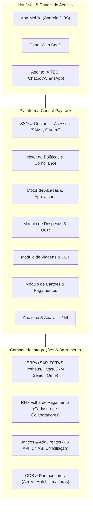
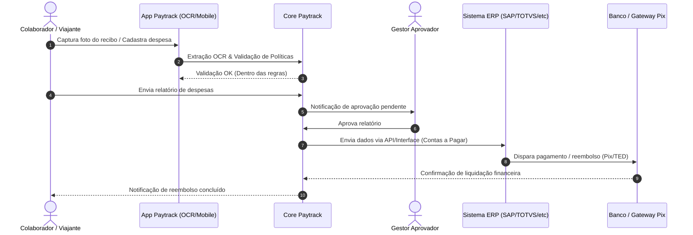

# Visão Geral e Arquitetura da Plataforma Paytrack

## 1. Contexto e Proposta de Valor

A **Paytrack** (pertencente ao Grupo Stefanini) é uma das principais plataformas corporativas do Brasil voltada à gestão integrada de viagens, despesas, reembolsos e pagamentos corporativos.

O ecossistema foi projetado para atender médias e grandes empresas, eliminando processos manuais em papel ou planilhas, garantindo conformidade com políticas internas e proporcionando auditoria contínua através de inteligência artificial e integrações nativas com sistemas legados (ERPs, folha de pagamento, bancos e agências de viagens).

---

## 2. Pilares Fundamentais do Sistema

| Pilar | Descrição | Principais Benefícios |
| :--- | :--- | :--- |
| **Gestão de Despesas & Reembolsos** | Registro digital de notas/recibos via OCR, controle de quilometragem por GPS, solicitação e prestação de contas de adiantamentos. | Redução drástica do ciclo de reembolso (de dias para minutos) e erradicação de extravios. |
| **Viagens Corporativas (OBT)** | *Online Booking Tool* corporativo para emissão de voos, hospedagens e locação com regras pré-configuradas e alçadas de aprovação. | Visibilidade pré-gasto, respeito ao *Duty of Care* e negociação direta de acordos corporativos. |
| **Cartão Corporativo & Pagamentos** | Cartões físicos e virtuais integrados, conciliação de faturas em tempo real, liquidação via Pix e fundo fixo digital. | Autonomia aos colaboradores em campo sem perda do controle orçamentário. |
| **Inteligência Artificial (Intelligence & TEO)** | Leitura automatizada de dados tributários em recibos, validação preditiva de fraudes e duplicidades, e agente interativo. | Automação da auditoria financeira e atendimento ágil sem sobrecarga do time interno. |
| **Interoperabilidade & Integração ERP** | Barramento de dados flexível com suporte a REST APIs, Webhooks, arquivos remessa/retorno e sincronização periódica. | Contabilização e baixa automatizada em contas a pagar sem digitação duplicada. |

---

## 3. Arquitetura de Componentes e Serviços

### 3.1. Camada de Apresentação (Frontend & Mobilidade)
- **Portal Web Corporativo**: Interface responsiva para gestores, auditores fiscais/financeiros e administradores.
- **Aplicativo Móvel Nativo/Híbrido**: Otimizado para lançamento rápido de comprovantes em trânsito (câmera com auto-recorte e OCR), acompanhamento de solicitações e aprovações rápidas com 1 toque.
- **Canal Conversacional TEO**: Agente disponível para consultas rápidas, dúvidas de políticas e aprovações via mensageria.

### 3.2. Camada de Aplicação e Negócios (SaaS Core)
- **Motor de Regras de Políticas (Policy Engine)**:
  - Avaliação de limites de gastos por categoria (alimentação, transporte, hospedagem).
  - Verificação de antecedência mínima de compra em viagens.
  - Bloqueio ou sinalização de violação de *Merchant Category Code* (MCC) em cartões.
- **Motor de Workflows e Alçadas (Approval Workflow Engine)**:
  - Roteamento dinâmico baseado em hierarquia (gestor imediato, diretor, financeiro), centro de custo, projeto ou valor da solicitação.
  - Aprovação multinível e aprovação por exceção.
- **Serviço de OCR & Extração Fiscal**:
  - Reconhecimento óptico de caracteres em cupom fiscal (NFC-e, CF-e SAT, NFS-e, recibos manuais).
  - Extração de CNPJ do emissor, data da emissão, itens discriminados, valor total e alíquotas.

### 3.3. Camada de Dados e Auditoria
- **Base Transacional**: Armazenamento relacional dos lançamentos, viagens, históricos e estados dos formulários.
- **Trilha de Auditoria Imutável (Audit Trail)**: Registro com carimbo de tempo (*timestamp*), IP e autor de cada ação (criação, edição, anexo, aprovação, reprovação e exportação).
- **Repositório Seguro de Comprovantes (Blob/Storage)**: Armazenamento criptografado de comprovantes digitais com retenção em conformidade legal e tributária.

---

## 4. Topologia de Integrações Corporativas

---

## 5. Diretrizes de Segurança e Compliance
1. **LGPD (Lei Geral de Proteção de Dados - Lei 13.709/2018)**:
   - Criptografia em trânsito (TLS 1.3) e em repouso (AES-256).
   - Anonimização e controle de acesso baseado em papéis (RBAC - *Role-Based Access Control*).
2. **Duty of Care**:
   - Rastreamento e geolocalização de viajantes a trabalho em situações de risco ou emergência global.
3. **Auditabilidade Fiscal**:
   - Manutenção de documentos fiscais digitalizados prontos para auditorias externas (Receita Federal, Big Four e auditorias internas).
