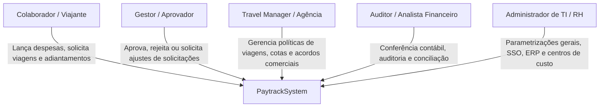
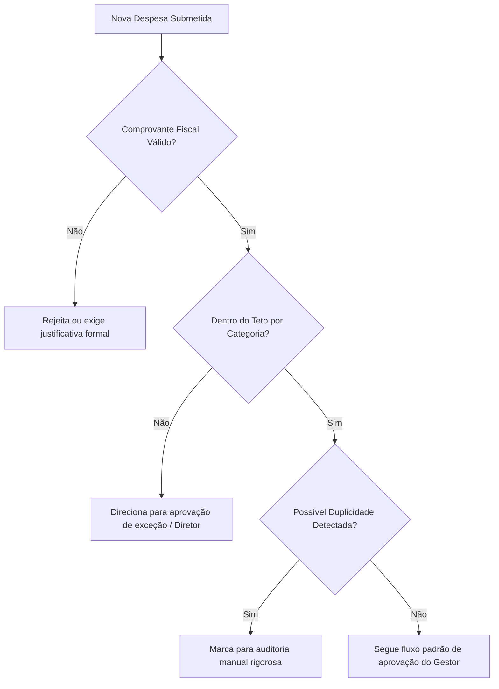

# Levantamento de Requisitos e Regras de Negócio

## 1. Mapeamento de Personas e Atores

| Ator / Persona | Papel no Sistema | Necessidades Principais |
| :--- | :--- | :--- |
| **Colaborador / Viajante** | Usuário final operacional que realiza despesas ou viaja a trabalho. | Agilidade no lançamento via celular, transparência no status do reembolso e facilidade no self-booking. |
| **Gestor / Aprovador** | Responsável pelo centro de custo ou linha hierárquica. | Visibilidade orçamentária em tempo real, aprovação rápida por app/e-mail e alertas de desvios. |
| **Travel Manager** | Gestor de viagens e eventos corporativos. | Controle de tarifas acordadas, garantia de antecedência mínima de compra e segurança (*Duty of Care*). |
| **Auditor / Financeiro** | Equipe de Contas a Pagar, Controladoria e Fiscal. | Conciliação automática de faturas de cartão, conferência fiscal (OCR/XML) e exportação contábil para o ERP. |
| **Administrador (TI/RH)** | Administrador do sistema e integrações. | Sincronização automatizada de colaboradores, catálogo de centros de custo e monitoramento de APIs. |

---

## 2. Requisitos Funcionais (RF)

### 2.1. Gestão de Despesas e Reembolsos
- **RF01 - Captura Digital e OCR**: O sistema deve permitir o upload ou captura fotográfica de comprovantes (recibos, NFC-e, NFS-e) com leitura automática de data, valor, fornecedor, CNPJ e itens via OCR.
- **RF02 - Relatório de Despesas (Prestação de Contas)**: O sistema deve possibilitar o agrupamento de despesas em um único relatório de prestação de contas associado a um período, projeto ou viagem.
- **RF03 - Cálculo de Quilometragem (KM)**: O sistema deve calcular automaticamente a distância percorrida utilizando mapa/GPS integrado (origem, destino e paradas intermediárias), aplicando o valor padrão do KM reembolsável configurado por política.
- **RF04 - Gestão de Adiantamentos**: O sistema deve permitir a solicitação de adiantamento financeiro, com aprovação prévia, provisionamento no ERP e dedução automática no momento da prestação de contas.
- **RF05 - Rateio Contábil**: O sistema deve suportar rateio de despesas entre múltiplos centros de custo, unidades/filiais e projetos por percentual ou valor fixo.
- **RF06 - Conversão Multi-moeda**: O sistema deve converter automaticamente despesas realizadas em moedas estrangeiras para a moeda local com base no câmbio da data da transação ou no comprovante de conversão.

### 2.2. Viagens Corporativas (OBT - Online Booking Tool)
- **RF07 - Busca e Emissão de Aéreo**: O sistema deve integrar-se aos GDS (Sabre, Amadeus, etc.) e companhias aéreas para busca, seleção de melhores tarifas corporativas e emissão de bilhetes dentro da política.
- **RF08 - Reserva de Hospedagem**: O sistema deve disponibilizar catálogo de hotéis nacionais e internacionais, com tarifas negociadas e regras de teto de diária por praça/cidade.
- **RF09 - Aluguel de Veículos**: O sistema deve oferecer integração com locadoras de automóveis homologadas com regras de categorias de veículos permitidas por nível hierárquico.
- **RF10 - Gestão de Grupos e Eventos**: O sistema deve viabilizar a criação de fluxos específicos para caravanas, convenções e treinamentos com orçamentos globais e limites por participante.
- **RF11 - Gestão de Bilhetes Não Voados (Credit Shell / Lost Ticket)**: O sistema deve alertar e reaproveitar créditos de passagens canceladas ou remarcadas para evitar perdas financeiras.

### 2.3. Cartões Corporativos e Pagamentos
- **RF12 - Gestão de Cartões Físicos e Virtuais**: O sistema deve permitir a solicitação, emissão, ativação, bloqueio temporário e cancelamento de cartões de débito/crédito corporativos.
- **RF13 - Conciliação Automática de Faturas**: O sistema deve parear automaticamente cada transação de cartão com a respectiva nota/comprovante enviada pelo colaborador.
- **RF14 - Alocação Dinâmica de Limites (Fundo Fixo)**: O sistema deve possibilitar a alteração programada ou pontual do limite de gastos de um cartão conforme cronograma de viagem ou projeto.
- **RF15 - Pagamentos via Pix**: O sistema deve permitir liquidação instantânea de despesas emergenciais ou reembolsos aprovados utilizando a rede Pix.

### 2.4. Motor de Aprovações e Governança
- **RF16 - Alçadas Multinível Flexíveis**: O sistema deve suportar rotas de aprovação configuráveis por valor, cargo do solicitante, desvios de política e centros de custo envolvidos.
- **RF17 - Aprovação por Dispositivos Móveis e Canais Externos**: O sistema deve permitir aprovação via push notification, app móvel e e-mail com tokens seguros de autenticação.
- **RF18 - Delegação de Alçadas (Ausência/Férias)**: O sistema deve viabilizar a transferência temporária de poderes de aprovação para outro gestor com data de início e término programadas.

### 2.5. Inteligência Artificial e Auditoria
- **RF19 - Auditoria Preditiva de Despesas**: O sistema deve detectar automaticamente inconsistências como comprovantes duplicados (mesmo CNPJ, valor e data), gastos em horários atípicos ou itens não permitidos (ex: bebidas alcoólicas).
- **RF20 - Assistente TEO**: O sistema deve prover assistente conversacional capaz de responder dúvidas sobre regras de viagem, saldo de cartão e status de solicitações.

### 2.6. Integrações e Exportações
- **RF21 - Sincronização de Cadastros (Inbound ERP/RH)**: O sistema deve importar periodicamente colaboradores, estruturas organizacionais, centros de custo e planos de contas.
- **RF22 - Integração Financeira (Outbound ERP)**: O sistema deve gerar títulos a pagar e lançamentos contábeis no ERP após a aprovação final da prestação de contas.
- **RF23 - Arquivos de Remessa e Retorno Bancário**: O sistema deve gerar e processar arquivos bancários padrão Febraban (CNAB 240/400) para processamento em lote quando o Pix direto não for utilizado.

---

## 3. Requisitos Não Funcionais (RNF)

| Identificador | Categoria | Descrição |
| :--- | :--- | :--- |
| **RNF01** | **Disponibilidade** | A plataforma SaaS deve manter disponibilidade mínima de 99,8% (*Service Level Agreement*). |
| **RNF02** | **Desempenho** | O processamento de OCR e extração de dados de comprovantes deve ocorrer em menos de 5 segundos sob condições normais de rede. |
| **RNF03** | **Segurança da Informação** | Comunicações criptografadas ponta a ponta com TLS 1.3; senhas com hash forte (Argon2 ou bcrypt); dados sensíveis em repouso com AES-256. |
| **RNF04** | **Autenticação e SSO** | Suporte a Single Sign-On corporativo via SAML 2.0, OpenID Connect, Microsoft Azure AD / Entra ID e Google Workspace. |
| **RNF05** | **Escalabilidade** | Arquitetura capaz de suportar picos de fechamento contábil mensal sem degradação perceptível no tempo de resposta. |
| **RNF06** | **Mobilidade Offline** | O aplicativo móvel deve permitir a captura e armazenamento local de recibos em modo offline, sincronizando automaticamente ao recuperar conexão. |
| **RNF07** | **Compatibilidade Multiplataforma** | Acesso web via navegadores modernos (Chrome, Edge, Firefox, Safari) e apps móveis compatíveis com iOS (>= 15) e Android (>= 10). |
| **RNF08** | **Privacidade e LGPD** | Conformidade plena com a LGPD: consentimento de dados, retenção parametrizada e possibilidade de expurgo seguro de dados de ex-colaboradores. |
| **RNF09** | **Trilha de Auditoria (Audit Log)** | Imutabilidade e persistência de 5 anos de todos os registros de aprovação, alteração de valores e exclusão para fins de compliance. |
| **RNF10** | **Resiliência de Integração** | Fila assíncrona com retentativas exponenciais (*exponential backoff*) e *dead-letter queue* para envio de dados ao ERP. |

---

## 4. Regras de Negócio (RN)

- **RN01 - Obrigatoriedade de Comprovante**: Todas as despesas superiores a R$ 0,00 devem conter comprovante anexado, exceto despesas de quilometragem apuradas via cálculo de rota por mapa.
- **RN02 - Alçada por Teto de Categoria**: Toda despesa que exceder o teto estipulado pela política corporativa (ex: R$ 80,00 para almoço) exige justificativa obrigatória e aprovação adicional da diretoria ou comitê de compliance.
- **RN03 - Detecção de Duplicidade Fiscal**: Se um comprovante com a mesma chave de acesso fiscal (NFC-e/NF-e) ou mesma combinação de [CNPJ do Fornecedor + Data + Valor] for submetido por mais de um usuário ou em relatórios distintos, o sistema deve bloquear o envio ou alertar a auditoria.
- **RN04 - Trava de Deslocamento Habitual em KM**: O cálculo de reembolso de quilometragem de deslocamento profissional deve prever a opção de abatimento do percurso habitual entre a residência do colaborador e o escritório sede.
- **RN05 - Bloqueio de Conciliação em Aberto**: Colaboradores que possuam prestações de contas vencidas ou pendentes há mais de 30 dias têm seus pedidos de adiantamento ou emissão de novas viagens bloqueados até a regularização.
- **RN06 - Antecedência Mínima de Viagem**: Solicitações de viagens nacionais devem ser realizadas com no mínimo 10 dias de antecedência, e internacionais com 21 dias. Emissões fora do prazo demandam justificativa executiva e aprovação extraordinária.
- **RN07 - Menor Tarifa Lógica (Lost Savings)**: Se o viajante optar por um voo ou hotel que não seja a menor tarifa disponível dentro da faixa de horário permitida, o sistema deve registrar a perda de economia (*Lost Savings*) e notificar o gestor aprovador.
- **RN08 - Restrição de Categoria por MCC em Cartões**: Transações de cartão corporativo em estabelecimentos com MCC bloqueados (ex: jogos de azar, joalherias, casas noturnas) são recusadas instantaneamente na ponta adquirente.
- **RN09 - SLA de Aprovação de Gestores**: Gestores possuem até 5 dias úteis para deliberar sobre uma prestação de contas. Ultrapassado o prazo, o sistema dispara alertas escalonados para o superior hierárquico.
- **RN10 - Encerramento Contábil Mensal**: Não é permitido submeter despesas de competências fiscais já encerradas no ERP pela controladoria sem aprovação formal extraordinária.
