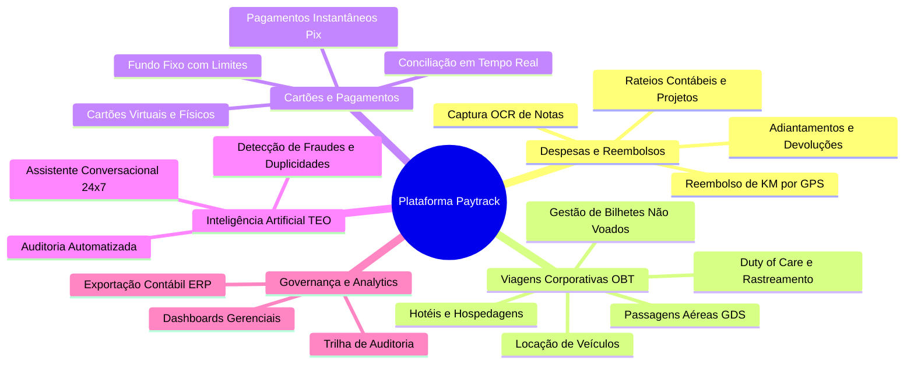
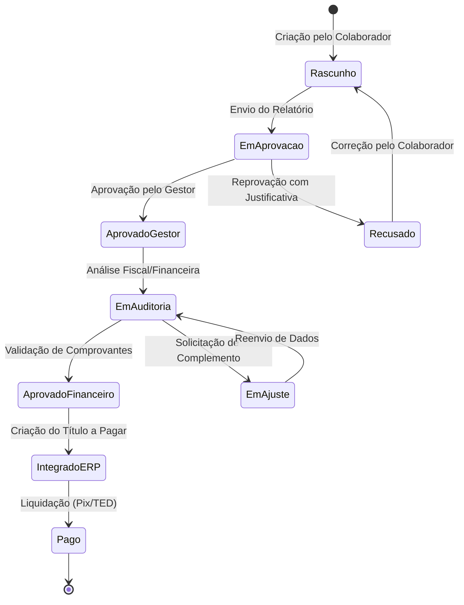
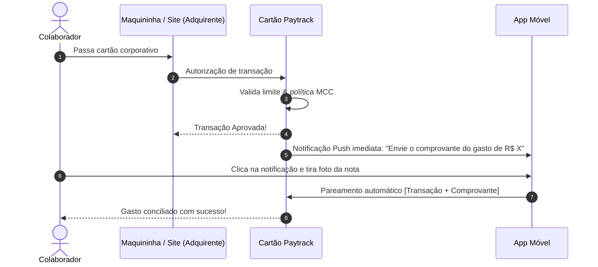

# Detalhamento de Módulos e Funcionalidades

## 1. Visão Sistêmica dos Módulos

A plataforma Paytrack estrutura-se em cinco grandes módulos operacionais integrados:

---

## 2. Módulo 1: Gestão de Despesas e Reembolsos

### 2.1. Ciclo de Vida da Despesa

### 2.2. Captura Inteligente e OCR (Optical Character Recognition)
- **Leitura de Comprovantes**: O motor de visão computacional analisa documentos em PDF, JPG, PNG e lê o QR Code da Nota Fiscal de Consumidor Eletrônica (NFC-e / SAT).
- **Extração Semântica**:
  - Razão Social e CNPJ do Fornecedor.
  - Data e Hora exata da transação.
  - Discriminação de itens e valores unitários.
  - Valor bruto, descontos e tributos destacados.
- **Auto-preenchimento**: Ao capturar a foto, os campos do formulário (categoria, valor, data, estabelecimento) são preenchidos automaticamente, exigindo do usuário apenas a conferência e vinculação a um projeto ou centro de custo.

### 2.3. Gestão e Reembolso de Quilometragem (KM)
- **Roteirização por GPS e Google Maps**:
  - Usuário insere ponto de partida, paradas e ponto final.
  - O sistema calcula a distância real em quilômetros via API de mapas.
- **Desconto de Deslocamento Residencial**:
  - Dedução opcional do trajeto diário padrão (casa-trabalho) em conformidade com as regras corporativas.
- **Tabelas de Tarifas por Perfil**:
  - Valores diferenciados por KM rodado com base no tipo de veículo (veículo próprio, utilitário, moto) ou combustível.
- **Auditoria de Desvio**:
  - Sinalização de divergências caso o usuário tente informar quilometragem superior à rota otimizada sugerida pelo mapa.

### 2.4. Adiantamentos e Prestação de Contas
- **Solicitação Antecipada**: Colaborador solicita valor para despesas extraordinárias de viagem ou projeto antes da realização dos gastos.
- **Aprovação e Provisionamento**: O pedido segue para alçada do gestor e, após aprovação, é integrado ao ERP para liberação dos fundos.
- **Encontro de Contas**:
  - As despesas realizadas são debitadas do saldo adiantado.
  - *Saldo Positivo a Reembolsar*: O valor excedente é pago ao colaborador.
  - *Saldo Negativo a Devolver*: O colaborador recebe orientações e chave Pix para devolução do recurso não utilizado à empresa.

---

## 3. Módulo 2: Viagens Corporativas (*Online Booking Tool*)

### 3.1. Funcionalidades de Reserva (Self-Booking)
- **Aéreo Nacional e Internacional**:
  - Conexão em tempo real com GDS (Global Distribution Systems como Sabre, Amadeus, Travelport) e companhias Low-Cost.
  - Exibição de regras de bagagem, flexibilidade de remarcação e classes de cabine autorizadas.
- **Hospedagem Corporativa**:
  - Acesso a tarifas públicas, canais consolidados e acordos diretos da empresa com redes hoteleiras.
  - Bloqueio por teto de diária com base na localidade de destino.
- **Locação de Automóveis**:
  - Integração com as principais locadoras com seguros obrigatórios embutidos (LDW/CDW).

### 3.2. Governança e Janela de Antecedência
- **Política de Compra Antecipada**:
  - Parâmetros configuráveis por dias de antecedência (ex: 7, 10 ou 21 dias).
  - Compras urgentes acionam alçadas extras de aprovação imediata.
- **Algoritmo de Menor Tarifa Lógica (*Lost Savings*)**:
  - Apresenta as opções mais econômicas disponíveis dentro de uma janela de conveniência de horário (+/- 2 horas).
  - Caso o colaborador escolha uma opção mais cara, o sistema exige seleção de motivo (ex: reunião agendada, conexão inviável) e reporta o custo adicional ao gestor.

### 3.3. Gestão de Bilhetes Não Voados (*Credit Shell*)
- Rastreamento sistemático de passagens emitidas e canceladas que geraram créditos corporativos.
- Aplicação prioritária desses créditos em novas viagens antes da emissão de um novo bilhete pago integralmente.

### 3.4. Duty of Care (Segurança e Rastreamento)
- Painel com mapa geolocalizado indicando colaboradores em viagem em tempo real.
- Disparo de alertas em massa (SMS/App/E-mail) em caso de crises climáticas, greves ou emergências na cidade de destino.

---

## 4. Módulo 3: Cartão Corporativo e Pagamentos

### 4.1. Cartões Virtuais e Físicos
- **Cartão Físico**:
  - Destinado a diretores, gerentes e equipes de campo frequentes.
  - Chip, contactless e bandeira internacional.
- **Cartão Virtual**:
  - Geração sob demanda para compras pontuais na web (softwares SaaS, licenças, inscrições em eventos).
  - Pode ser configurado para expirar após 1 uso ou com limite de valor estrito.

### 4.2. Fluxo de Conciliação em Tempo Real

### 4.3. Restrições e Controles por MCC
- Parametrização de bloqueios para códigos de categoria de comerciantes não autorizados:
  - Permitidos: Hotéis, Companhias Aéreas, Restaurantes, Postos de Combustíveis, Transporte por App.
  - Bloqueados: Jogos de azar, joalherias, vestuário pessoal, entretenimento adulto.

### 4.4. Pagamentos via Pix e Fundo Fixo Digital
- Pagamentos de fornecedores e reembolsos instantâneos via chave Pix corporativa.
- Fundo fixo para pequenas compras de caixa de filial ou canteiro de obras, substituindo caixas físicos e planilhas em papel.

---

## 5. Módulo 4: Inteligência Artificial (TEO & Intelligence)

### 5.1. Pré-Auditoria e Detecção de Anomalias
- **Detecção de Fraudes**:
  - Identificação de notas fiscais adulteradas digitalmente.
  - Alerta de mesma nota fiscal submetida em contas diferentes.
- **Análise Semântica de Itens**:
  - Identificação de itens proibidos nas notas detalhadas (ex: bebidas alcoólicas, produtos de tabacaria, cosméticos não corporativos).
- **Padrões de Horário e Localização**:
  - Cruzamento de dados de localização do colaborador com o endereço do estabelecimento no momento do consumo.

### 5.2. Agente Conversacional TEO
- Chatbot acessível no aplicativo móvel, web e canais de mensageria corporativa.
- Capacidades operacionais:
  - *"Qual é o meu saldo disponível no cartão?"*
  - *"Minha prestação de contas de viagens já foi aprovada?"*
  - *"Qual é o limite de diária de hotel em São Paulo para meu cargo?"*
  - *"Lembre o meu gestor de aprovar o relatório pendente."*

---

## 6. Módulo 5: Governança, Compliance e Auditoria

### 6.1. Matriz de Alçadas de Aprovação
As aprovações são determinadas dinamicamente por três dimensões:
1. **Valor Total**:
   - Até R$ 500: Gestor Imediato.
   - De R$ 500,01 a R$ 5.000: Gestor + Gerente de Área.
   - Acima de R$ 5.000: Gestor + Diretor de Divisão.
2. **Desvio de Política**:
   - Qualquer despesa fora de política aciona obrigatoriamente um nível adicional (Comitê ou Diretoria).
3. **Centro de Custo Pertencente**:
   - Aprovação cruzada caso o colaborador aloque a despesa no centro de custo de outro departamento.

### 6.2. Trilha de Auditoria (Audit Trail)
- Registro cronológico imutável para cada evento de sistema contendo:
  - `ID_Evento`
  - `Timestamp_UTC`
  - `Usuario_Responsavel` (ID, Nome, E-mail)
  - `Endereco_IP` e `Dispositivo`
  - `Acao_Realizada` (Ex: `DESPESA_CRIADA`, `VALOR_ALTERADO`, `RELATORIO_APROVADO`)
  - `Snapshot_Antes` vs `Snapshot_Depois` (para alterações de valores ou comprovantes)
