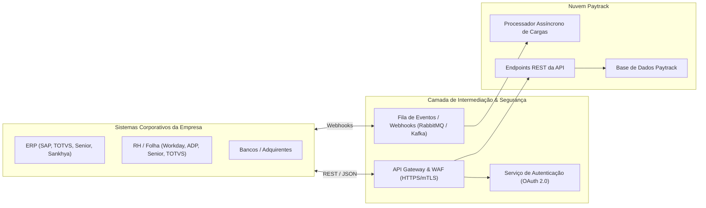
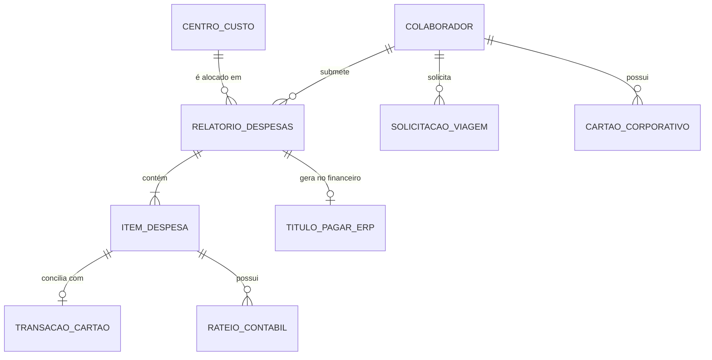
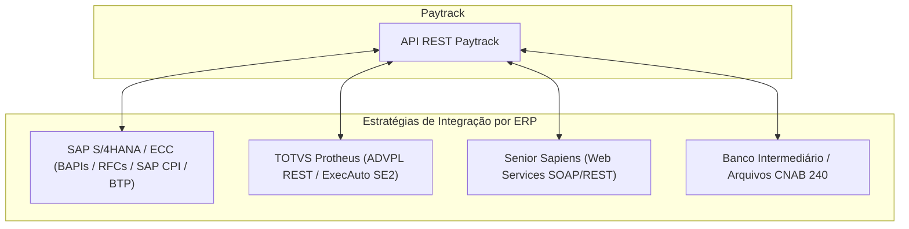

# Guia Técnico de Integrações e Especificação de API

## 1. Visão Geral da Arquitetura de Integração

A Paytrack opera sob o conceito de **Plataforma Aberta e Integrável**, permitindo sincronização bidirecional de dados entre o ecossistema corporativo (ERPs, folhas de pagamento, bancos) e a nuvem Paytrack.



---

## 2. Autenticação e Segurança da API

### 2.1. Métodos de Autenticação
1. **OAuth 2.0 (Client Credentials Grant - Recomendado para integrações máquina a máquina)**:
   - Endpoint de Token: `POST https://api.paytrack.com.br/oauth/token`
   - Parâmetros: `client_id`, `client_secret`, `grant_type=client_credentials`.
   - Resposta: Token JWT no cabeçalho `Authorization: Bearer <token>` com validade configurável (padrão: 3600 segundos).
2. **API Key (X-Api-Key)**:
   - Chave permanente para ambientes de desenvolvimento ou conectores específicos.
   - Fornecida no cabeçalho HTTP: `X-Paytrack-ApiKey: <hash_da_chave>`.

### 2.2. Políticas de Proteção
- **Rate Limiting**: Limite padrão de 1.000 requisições por minuto por chave/tenant.
- **Idempotência**: Suporte ao cabeçalho `Idempotency-Key: <UUID>` em requisições `POST` e `PUT` para evitar duplicações acidentais em caso de falha de conexão.
- **IP Whitelisting**: Possibilidade de restrição por faixas de IP público do cliente em ambientes de produção.

---

## 3. Modelo de Dados e Catálogo de Entidades



---

## 4. Especificação de Endpoints REST

### 4.1. Sincronização de Colaboradores (Inbound: RH -> Paytrack)
Atualiza a base de usuários com permissões, cargos e gestores imediatos.

- **Método / Rota**: `POST /v1/employees/sync`
- **Exemplo de Payload de Requisição (JSON)**:
```json
{
  "employee_id": "EMP-94021",
  "name": "Carlos Eduardo Silva",
  "email": "carlos.silva@empresa.com.br",
  "cpf": "12345678900",
  "cost_center_code": "CC-FIN-001",
  "role": "Analista Financeiro Sênior",
  "manager_employee_id": "EMP-82100",
  "active": true,
  "bank_details": {
    "bank_code": "001",
    "branch": "1234",
    "account": "56789-0",
    "pix_key": "carlos.silva@empresa.com.br",
    "pix_key_type": "EMAIL"
  }
}
```
- **Código de Resposta**: `200 OK` (ou `201 Created`) com ID único registrado no Paytrack.

---

### 4.2. Consulta de Relatórios Aprovados para Faturamento (Outbound: Paytrack -> ERP)
Obtém relatórios de despesas com todas as aprovações concluídas e prontos para geração de contas a pagar no ERP.

- **Método / Rota**: `GET /v1/expense-reports?status=APPROVED_FINANCE&date_from=2026-10-01`
- **Exemplo de Resposta (JSON)**:
```json
{
  "total_records": 1,
  "page": 1,
  "data": [
    {
      "report_id": "EXP-2026-8819",
      "employee_id": "EMP-94021",
      "employee_name": "Carlos Eduardo Silva",
      "title": "Visita Técnica e Alinhamento Filial Curitiba",
      "total_amount": 1420.50,
      "currency": "BRL",
      "status": "APPROVED_FINANCE",
      "approval_date": "2026-10-14T18:30:00Z",
      "advance_deducted": 500.00,
      "net_reimbursement_amount": 920.50,
      "expenses": [
        {
          "expense_id": "ITEM-1001",
          "category": "HOSPEDAGEM",
          "expense_date": "2026-10-10",
          "amount": 620.00,
          "supplier_cnpj": "12345678000199",
          "supplier_name": "Hotel Central Curitiba Ltda",
          "invoice_number": "00045920",
          "receipt_url": "https://storage.paytrack.com.br/receipts/2026/exp_1001.pdf",
          "cost_splits": [
            {
              "cost_center_code": "CC-FIN-001",
              "percentage": 100.0,
              "amount": 620.00
            }
          ]
        },
        {
          "expense_id": "ITEM-1002",
          "category": "KM_RODADO",
          "expense_date": "2026-10-11",
          "amount": 300.50,
          "distance_km": 240.4,
          "rate_per_km": 1.25,
          "route": {
            "origin": "Joinville - SC",
            "destination": "Curitiba - PR"
          }
        }
      ]
    }
  ]
}
```

---

### 4.3. Notificação de Baixa / Pagamento Realizado (Inbound: ERP -> Paytrack)
Atualiza o relatório com o código do documento contábil gerado no ERP e confirma a liquidação financeira.

- **Método / Rota**: `PATCH /v1/expense-reports/{report_id}/settlement`
- **Exemplo de Payload (JSON)**:
```json
{
  "erp_document_number": "DOC-SAP-510009281",
  "settlement_date": "2026-10-15",
  "settled_amount": 920.50,
  "payment_method": "PIX",
  "payment_reference_id": "E00000000202610151200abc12345678",
  "status": "SETTLED"
}
```

---

## 5. Arquitetura de Webhooks (Mensageria e Tempo Real)

A Paytrack emite eventos HTTP POST para os endpoints de Webhooks cadastrados pelos clientes.

### 5.1. Cabeçalho de Assinatura Criptográfica
Cada disparo inclui o cabeçalho:
`X-Paytrack-Signature: sha256=e3b0c44298fc1c149afbf4c8996fb92427ae41e4649b934ca495991b7852b855`
O backend receptor deve calcular o HMAC-SHA256 do corpo da mensagem com sua chave secreta e validar a integridade.

### 5.2. Eventos Suportados
| Evento | Momento do Disparo | Ação Típica no ERP |
| :--- | :--- | :--- |
| `expense_report.approved` | Relatório teve aprovação final de alçada. | Provisionar título de contas a pagar no ERP. |
| `advance_request.approved` | Pedido de adiantamento aprovado. | Liberar pagamento/TED/Pix para o colaborador. |
| `card.transaction_created` | Transação de cartão autorizada pela bandeira. | Notificar colaborador no app e alertar tesouraria. |
| `travel.ticket_issued` | Bilhete aéreo ou hotel confirmado. | Alocar custo no centro de custo do projeto. |

---

## 6. Padrões de Conexão com os Principais ERPs



### 6.1. Integração com SAP (S/4HANA & ECC)
- **Métodos**:
  - RFC / BAPI (`BAPI_ACC_DOCUMENT_POST` para lançamentos contábeis).
  - SAP Integration Suite / BTP ou SAP CPI consumindo a API REST da Paytrack.
- **Campos Mapeados**: Fornecedor (KUNNR/LIFNR), Conta do Razão (HKONT), Centro de Custo (KOSTL), Ordem Interna (AUFNR), Código de Imposto (MWSKZ).

### 6.2. Integração com TOTVS Protheus
- **Métodos**:
  - Rotinas automáticas ADVPL (`MSExecAuto`) consumindo Web Services RESTful.
  - Títulos no Contas a Pagar (Tabela `SE2`): Tipo `PA` (Pagamento Antecipado para adiantamentos) e Tipo `ND` ou `NF` para despesas.
  - Centro de Custo (Tabela `CTT`), Naturezas Financeiras (Tabela `SED`).

### 6.3. Integração com Senior Sapiens
- **Métodos**:
  - Web Services SOAP (`com.senior.g5.co.mfi.cpa`) para inclusão de títulos a pagar e baixas.
  - Sincronização de colaboradores via módulo Senior HCM / Gestão de Pessoas.

---

## 7. Boas Práticas e Tratamento de Resiliência
1. **Tratamento de Indisponibilidade**: Implementar filas assíncronas (como RabbitMQ, AWS SQS ou Azure Service Bus) entre o ERP e a Paytrack com retentativas exponenciais em falhas HTTP `502`, `503` ou `504`.
2. **Prevenção de Duplicidade**: Sempre persistir e enviar o `Idempotency-Key` único correspondente a cada relatório processado.
3. **Logs Estruturados**: Armazenar log completo com Request ID, Timestamp, Payload, Status Code e tempo de resposta para qualquer chamada de sincronização.
