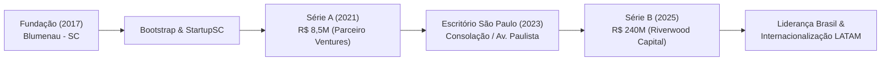
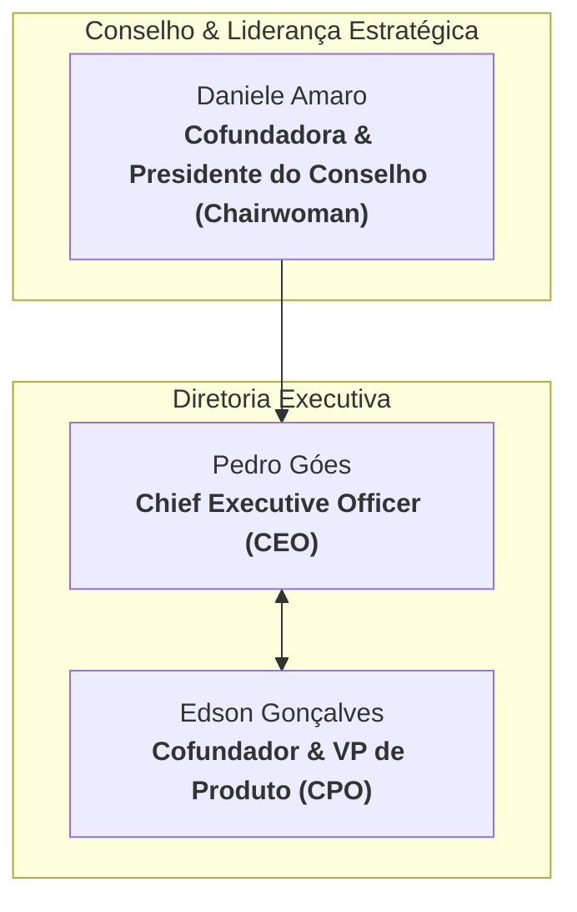
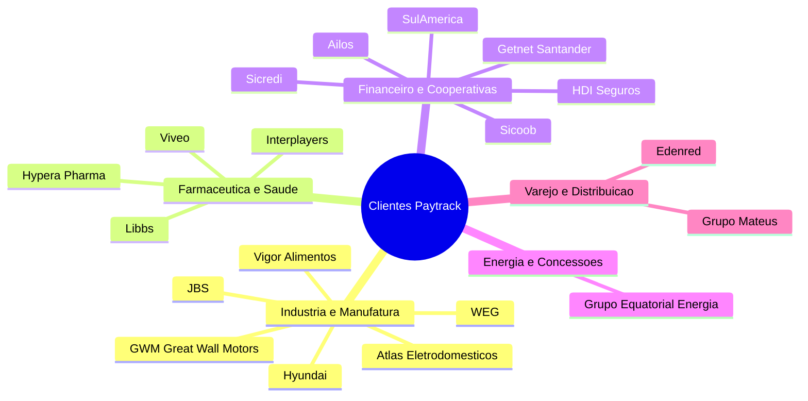
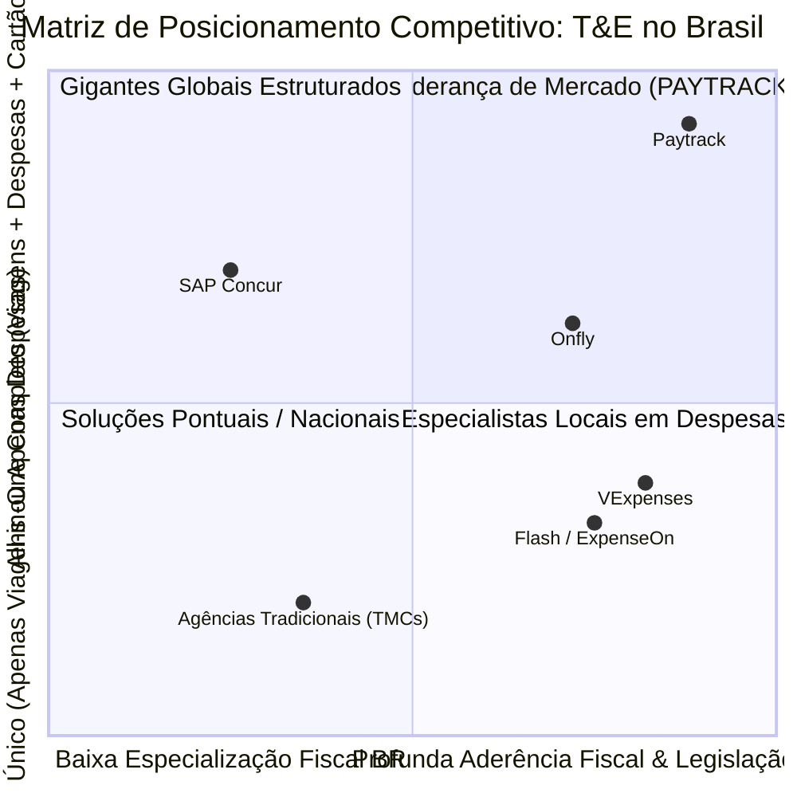

# Dossiê Institucional: Ecossistema e Inteligência Corporativa Paytrack

---

## 1. Ficha Técnica e Identidade da Empresa

| Atributo | Detalhe Corporativo |
| :--- | :--- |
| **Razão Social / Nome** | Paytrack Viagens e Despesas S.A. |
| **Fundação** | 2017 |
| **Cidade Sede (Matriz)** | Blumenau, Santa Catarina (Polo Tecnológico do Vale do Itajaí) |
| **Endereço Matriz** | Rodovia Paul Fritz Kuehnrich, 955 – 1º andar – Itoupava Norte, Blumenau/SC |
| **Escritório Corporativo** | Rua Bela Cintra, 986 – 15º andar – Consolação, São Paulo/SP (inaugurado em 2023) |
| **Tamanho da Equipe** | **500+ colaboradores** diretos |
| **Base de Clientes** | **7.000+ empresas clientes** |
| **Usuários Ativos** | **1 Milhão+ de colaboradores ativos** na plataforma |
| **Posicionamento** | Plataforma *All-in-One* de Gestão de Despesas, Viagens Corporativas, Cartão e Pagamentos |

---

## 2. Fundadores e Liderança Executiva

* **Daniele Amaro (Cofundadora & Presidente do Conselho)**:
  * Empreendedora e executiva de destaque no ecossistema de tecnologia de Santa Catarina. Liderou a empresa como CEO desde a fundação até o ciclo de atração de capital institucional, posicionando a Paytrack no ranking das scale-ups de maior crescimento do Brasil. Atualmente preside o Conselho de Administração.
* **Edson Gonçalves (Cofundador & VP de Produto)**:
  * Especialista em engenharia de software e arquitetura de sistemas com longa bagagem no polo de TI do Sul (passagens por referências do setor como a Senior Sistemas). Responsável direto pelo desenvolvimento do motor de regras, OCR, algoritmos de viagem e integrações com ERPs.
* **Pedro Góes (CEO)**:
  * Executivo responsável pela condução da operação, escala comercial, expansão de novas verticais (fintech e cartões) e expansão territorial na América Latina.

---

## 3. Histórico de Captação e Investidores

A Paytrack iniciou sua trajetória de forma enxuta (*bootstrap*), acelerada pelo programa **StartupSC** (Sebrae-SC), e transformou-se em uma das empresas de software B2B mais capitalizadas do país:

1. **Rodada Seed / Série A (2021) — R$ 8,5 Milhões**:
   * **Liderança**: *Parceiro Ventures* (fundo norte-americano focado em SaaS B2B com atuação na América Latina).
   * **Objetivo**: Estruturação dos módulos de viagens integradas e consolidação no mercado nacional.
2. **Rodada Série B (Janeiro de 2025) — R$ 240 Milhões**:
   * **Liderança**: **Riverwood Capital** (um dos maiores fundos globais de Private Equity / Venture Capital em tecnologia, investidor de gigantes como VTEX, 99, Omie e Cortex).
   * **Marco**: Um dos maiores aportes já realizados no setor de *Travel & Expense* (T&E) na história da América Latina.
   * **Destinação dos Recursos**:
     * Expansão internacional para a América Latina (México, Colômbia, Chile).
     * Escala da vertical de Meios de Pagamento (Fintech, cartões corporativos físicos/virtuais e liquidação Pix).
     * Investimento maciço em Inteligência Artificial Generativa e Agentes Autônomos (Ecossistema TEO e *Price Tracking*).

---

## 4. Carteira de Clientes e Segmentos de Atuação

A Paytrack consolidou forte presença no segmento **Enterprise** e médias empresas em setores de alta complexidade regulatória, logística e operacional:

### Principais Casos de Sucesso Comprovados:
* **Grupo Equatorial Energia**: Redução do ciclo de aprovação e emissão de viagens de 3 a 5 dias para poucos minutos (ganho de eficiência de 70% a 80%), além da integração nativa das estruturas orçamentárias de projetos via API.
* **WEG e JBS**: Gestão descentralizada de dezenas de milhares de colaboradores em trânsito com prestação de contas automatizada e auditoria fiscal contínua.
* **Cooperativas de Crédito (Sicredi, Sicoob, Ailos)**: Controle unificado de despesas administrativas de agências e fundos de caixa com compliance rígido.

---

## 5. Posicionamento Competitivo e Diferenciais de Mercado

O mercado de *Travel & Expense* (T&E) no Brasil é disputado por quatro perfis de concorrentes. O gráfico e a matriz a seguir ilustram o fosso competitivo (*moat*) da Paytrack:

### Análise Comparativa Detalhada:

| Solução | Perfil Principal | Pontos Fortes | Limitações / Desvantagens |
| :--- | :--- | :--- | :--- |
| **Paytrack** | **Plataforma All-in-One + TMC Integrada** | Viagens (OBT) + Despesas (OCR) + Cartão + Agência 24/7 própria. Motor de IA avançado (TEO). Conectores nativos para ERPs nacionais (TOTVS, Senior, SAP). | Foco predominante em médias e grandes contas corporativas (menos voltada para microempresas). |
| **SAP Concur** | Padrão Global Multinacional | Forte presença em multinacionais e integração com SAP global. | Custo altíssimo em moeda estrangeira; implantação lenta e complexa; baixa flexibilidade para especificidades fiscais brasileiras (NFC-e, adiantamentos CLT). |
| **Onfly** | Travel Tech focada em Booking | Excelente experiência de usuário (UX) em reservas aéreas e autosserviço ágil para PMEs. | Historicamente focada em viagens, expandindo despesas e cartões de forma mais recente; menor penetração em grandes indústrias complexas. |
| **VExpenses** | Gestão de Despesas & Reembolsos | Alta eficiência na digitalização de notas, leitura OCR e controle de equipes de campo. | Não possui DNA nativo de agência corporativa/OBT para reserva e emissão aérea global de alta complexidade. |
| **Agências Tradicionais (TMCs)** | Agências de Viagens Corporativas | Atendimento consultivo e negociação de grandes acordos aéreos. | Softwares defasados, dependência de OBTs legados de terceiros e ausência de módulo nativo de gestão e conciliação de despesas. |

---

## 6. O "Moat" (Diferenciais Insuperáveis) da Paytrack

1. **SaaS + TMC (Agência de Viagens Própria)**:
   * A Paytrack não é apenas uma produtora de software: possui registro de agência corporativa com acordos comerciais diretos com companhias aéreas e redes hoteleiras, oferecendo atendimento humano especializado e suporte emergencial 24/7.
2. **Conectividade Nativa com o Legado Brasileiro**:
   * Nascida no polo de software de Santa Catarina, a plataforma possui conectores pré-construídos para **TOTVS Protheus**, **Senior Sapiens**, **SAP** e **Sankhya**, respeitando retenções fiscais, naturezas financeiras e rotinas automáticas sem custos exorbitantes de customização.
3. **IA Própria para Previsão e Auditoria (*Price Tracking* & TEO)**:
   * Algoritmos que rastreiam o melhor momento financeiro para compra de passagens, além de auditoria preditiva que examina linha a linha dos cupons fiscais para expurgar gastos indevidos antes da aprovação do gestor.
4. **Governança de Cartão com Conciliação Instantânea**:
   * O gasto no cartão gera push imediato no celular do colaborador, garantindo que o comprovante seja anexado na hora, extinguindo o passivo de faturas abertas no fim do mês.
