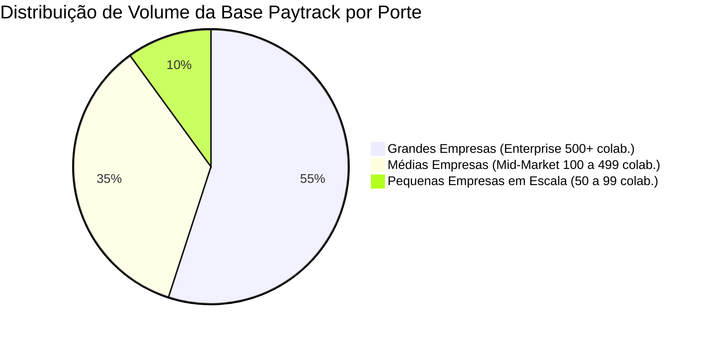
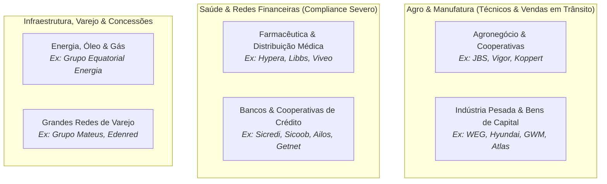
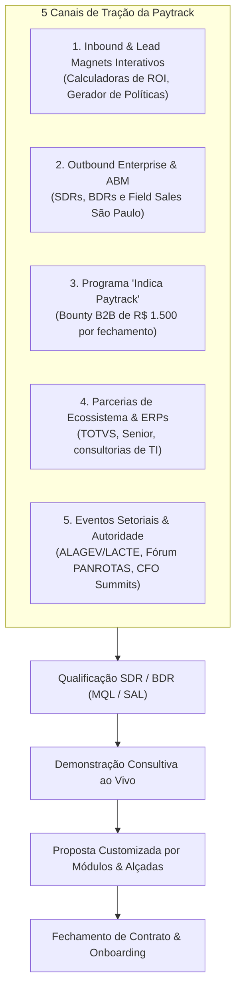

# Estratégia de Aquisição de Clientes (GTM) e Perfil de Cliente Ideal (ICP)

---

## 1. Perfil de Cliente Ideal (ICP - *Ideal Customer Profile*)

O foco estratégico da Paytrack é predominantemente o mercado **Mid-Market e Enterprise** (médias e grandes empresas) com operações distribuídas e alta complexidade de governança financeira e deslocamento de pessoas.

### 1.1. Critérios de Qualificação Firmográfica do ICP

| Dimensão | Perfil Mínimo Qualificado | Perfil Ideal de Alto Valor (*Sweet Spot*) |
| :--- | :--- | :--- |
| **Faturamento Anual** | A partir de R$ 30 Milhões/ano | Acima de R$ 100 Milhões a bilhões de reais |
| **Quadro de Colaboradores** | Mínimo de 80 a 100 funcionários | 300 a dezenas de milhares de colaboradores |
| **Volume de Viajantes/Campo** | Pelo menos 20 a 30 pessoas com despesas mensais | Mais de 100 pessoas em viagens ou deslocamentos frequentes |
| **Gasto Mensal em Viagens/T&E** | A partir de R$ 30.000 / mês | Acima de R$ 150.000 a R$ 2.000.000+ / mês |
| **Estrutura Operacional** | 1 matriz e equipe externa | Múltiplas filiais, canteiros de obra, fábricas ou subsidiárias |
| **ERP Corporativo** | ERP de mercado (Protheus, Senior, SAP, Omie) | SAP (ECC ou S/4HANA), TOTVS (Protheus/Datasul) ou Senior |

---

### 1.2. Segmentos Verticais Prioritários

A Paytrack possui forte aderência em setores com forças de campo ativas ou unidades descentralizadas:

---

### 1.3. O Comitê de Compra (*Buying Center*)
Nas vendas corporativas da Paytrack, o ciclo de decisão envolve múltiplos interlocutores:

1. **CFO / Diretor Financeiro / Controller (Decisor Financeiro)**:
   * *Dor*: Falta de visibilidade de caixa, extravio de comprovantes, atrasos no fechamento contábil mensal e risco fiscal/trabalhista em reembolsos.
   * *Valor entregue*: Governança unificada, redução de 70% no tempo de fechamento e auditoria com IA.
2. **Travel Manager / Gestor de Viagens (Usuário-Chave de Negócio)**:
   * *Dor*: Dificuldade de controlar tarifas, cancelamentos, créditos não voados e falta de suporte 24/7 para emergências dos viajantes.
   * *Valor entregue*: OBT moderno com algoritmo de menor tarifa, integração com agência própria e painel *Duty of Care*.
3. **CIO / Diretor de TI (Decisor Técnico)**:
   * *Dor*: Dificuldade de integrar ferramentas externas ao ERP e preocupações com segurança da informação.
   * *Valor entregue*: Conectores prontos para SAP/TOTVS/Senior, autenticação SSO e conformidade LGPD.
4. **Gerente de Compras / Procurement (Negociador de Contratos)**:
   * *Dor*: Múltiplos contratos fragmentados (uma agência de viagens, um software de despesas e um banco para cartões).
   * *Valor entregue*: Consolidação de fornecedores em uma única plataforma *all-in-one*.

---

## 2. Motores de Captação e Aquisição de Clientes (Go-to-Market)

A Paytrack opera sob um modelo de **Go-to-Market Híbrido**, combinando estratégias Inbound, Outbound Enterprise, programas de incentivo e alianças de ecossistema:

---

### 2.1. Inbound Marketing com "Lead Magnets" Interativos
Diferente do marketing tradicional baseado apenas em artigos estáticos, a Paytrack constrói ferramentas gratuitas que geram valor imediato e coletam dados críticos de qualificação:

* **Calculadora de Savings em Despesas**: O prospect insere o número de colaboradores e despesa média mensal; a ferramenta gera um diagnóstico imediato do potencial de corte de desperdícios (atraindo diretamente CFOs e diretores financeiros).
* **Gerador Automatizado de Políticas de Viagens Corporativas**: Questionário interativo que entrega uma política corporativa estruturada pronta para uso. Em troca, a Paytrack mapeia exatamente as regras, travas e fraquezas do prospect.
* **Calculadora de KM Rodado**: Ferramenta de atração para gestores de operações e frotas.
* **Mapa de Pix Saque e Troco**: Focado em equipes de tesouraria.
* **Webinars e Materiais Ricos**: Guias aprofundados sobre fechamento contábil, Sped, conformidade fiscal e reforma tributária.

---

### 2.2. Outbound Ativo e ABM (*Account-Based Marketing*)
Para conquistar gigantes como WEG, Hyundai e JBS, a Paytrack utiliza abordagens personalizadas:

* **Estrutura de SDRs e BDRs**: Segmentação por listas de empresas-alvo (*named accounts*) com pesquisa profunda de rotinas e ERP utilizado antes do primeiro contato.
* **Presença Física em São Paulo (Escritório Rua Bela Cintra)**:
  * Proximidade com as matrizes das maiores empresas do país.
  * Realização de reuniões presenciais (*Field Sales*), almoços de relacionamento e demonstrações com a diretoria.
* **Campanhas de ABM Multicanal**: Anúncios direcionados especificamente para diretores de empresas selecionadas no LinkedIn, acompanhados de cadências de e-mails executivos e abordagens consultivas.

---

### 2.3. Programa de Indicação B2B ("Indica Paytrack")
Um dos diferenciais mais agressivos da empresa no mercado nacional:
* **Mecânica**: Qualquer profissional (colaborador de cliente atual, consultor de processos, gestor ou parceiro) pode indicar um tomador de decisão de uma empresa com perfil elegível.
* **Recompensa Financeira**: **R$ 1.500,00** pagos diretamente ao indicador caso a indicação resulte em contrato fechado.
* **Efeito de Rede**: Profissionais de compras, viagens e finanças que mudam de empresa frequentemente levam a Paytrack para sua nova companhia, monetizando a recomendação.

---

### 2.4. Parcerias Estratégicas de Ecossistema (ERPs e Canais)
* **Ecossistema de ERPs do Sul e Nacionais**: Forte relacionamento histórico com canais e consultorias que implantam **Senior Sistemas** (conterrânea de Blumenau), **TOTVS** e **SAP**.
* **Consultorias de Auditoria e Redução de Custos**: Empresas de consultoria financeira indicam a Paytrack como ferramenta para operacionalizar auditorias contínuas.
* **Bandeiras e Adquirentes**: Parcerias com emissores de cartões para oferta conjunta da solução de T&E integrada ao cartão corporativo.

---

### 2.5. Eventos Especializados e Construção de Marca
* Patrocínio de destaque e palestras nos principais encontros da indústria de viagens corporativas e finanças:
  * **LACTE** ( promovido pela ALAGEV - Associação Latino-Americana de Gestores de Viagens e Eventos Corporativos).
  * **Fórum PANROTAS**, **CFO Summit Brasil**, encontros de mobilidade corporativa.
* Reconhecimentos de mercado como o prêmio **Top Sellers LATAM**, consolidando a reputação de confiabilidade exigida por grandes corporações.
