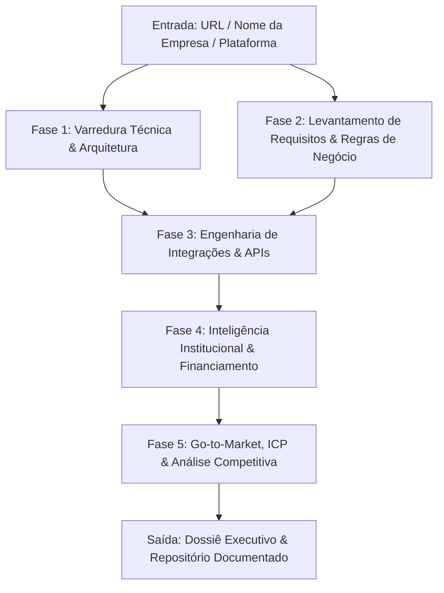

# Metodologia Padrão de Pesquisa, Engenharia de Requisitos e Inteligência Corporativa

---

## 1. Visão Geral e Propósito

Este documento formaliza o **framework padrão de pesquisa e análise de mercado** estabelecido a partir do estudo de referência da **Paytrack**. Ele deve ser utilizado obrigatoriamente como roteiro de execução para qualquer pesquisa de novas empresas, concorrentes, parceiros ou potenciais clientes.

O objetivo deste método é transformar qualquer ponto de partida simples (como uma URL ou nome institucional) em um **ecossistema de inteligência 360°**, integrando:
1. **Engenharia Técnica & Arquitetura de Software**;
2. **Business Intelligence & Finanças Corporativas**;
3. **Estratégia de Go-to-Market (GTM) e Perfil de Cliente Ideal (ICP)**;
4. **Diferenciação Competitiva e Moat de Mercado**.



---

## 2. As 5 Fases do Protocolo de Pesquisa

### Fase 1: Varredura Técnica, Arquitetura e Módulos
* **Objetivo**: Mapear a anatomia completa do produto de software.
* **Entregas Obrigatórias**:
  * Diagrama de arquitetura de componentes (Apresentação, Core SaaS, Barramento de Integração, Banco e Segurança).
  * Detalhamento de cada módulo operacional e seu ciclo de vida de dados (com diagramas de estado e sequência).
  * Identificação de recursos de IA, visão computacional, automação e integrações externas (GDS, gateways bancários, adquirentes).

### Fase 2: Levantamento de Requisitos e Regras de Negócio
* **Objetivo**: Documentar a engenharia de requisitos da solução como se fôssemos construí-la ou integrá-la.
* **Entregas Obrigatórias**:
  * Mapeamento completo de Atores e Personas corporativas.
  * Requisitos Funcionais (**RFs**) numerados e agrupados por domínio.
  * Requisitos Não Funcionais (**RNFs**) de segurança, SLA, tempo de resposta, escalabilidade e LGPD.
  * Regras de Negócio Críticas (**RNs**) com fluxogramas lógicos (travas de teto, alçadas e políticas).
  * Matriz de Rastreabilidade com priorização **MoSCoW** e Casos de Uso operacionais de ponta a ponta (**UCs**).

### Fase 3: Integrações, APIs e Conectores de ERP
* **Objetivo**: Fornecer a documentação técnica para viabilizar conexões sistêmicas imediatas.
* **Entregas Obrigatórias**:
  * Padrão de autenticação (OAuth 2.0 / API Keys) e políticas de proteção (rate limit, idempotência).
  * Modelagem de dados (diagrama de entidades e relacionamentos - ER).
  * Catálogo de endpoints REST essenciais com payloads JSON reais de requisição e resposta.
  * Catálogo de Webhooks com assinaturas de segurança HMAC.
  * Estratégias de conexão com os principais ERPs legados de mercado (SAP, TOTVS, Senior, Oracle, etc.).

### Fase 4: Inteligência Corporativa e Saúde Financeira
* **Objetivo**: Compreender quem são os donos, a liderança, o fôlego de capital e o tamanho real do negócio.
* **Entregas Obrigatórias**:
  * Ano de fundação, polo tecnológico de origem, matriz e filiais físicas.
  * Perfil dos fundadores (background técnico/comercial) e diretoria executiva atual.
  * Linha do tempo de captação de recursos: rodadas Seed, Série A, Série B, fundos de Venture Capital/Private Equity líderes e valores aportados.
  * Métricas de tração: faturamento estimado/ARR, total de clientes corporativos, usuários ativos e número de colaboradores diretos.
  * Carteira de clientes emblemáticos agrupados por setor industrial.

### Fase 5: Go-to-Market (GTM), ICP e Diferenciação Competitiva
* **Objetivo**: Entender com maestria como a empresa vende, para quem vende e por que vence a concorrência.
* **Entregas Obrigatórias**:
  * Perfil de Cliente Ideal (**ICP**): porte de faturamento, tamanho de equipe, nível de complexidade e ERP instalado.
  * Mapeamento do Comitê de Compra (*Buying Center*): dores e discurso de valor para CFO, Travel Manager, TI e Compras.
  * Motores de Aquisição (5 canais): Inbound interativo (ferramentas gratuitas/lead magnets), Outbound/ABM, Programas de Indicação/Incentivo B2B, Canais de ERP e Eventos do setor.
  * Matriz de Posicionamento Competitivo (*quadrantChart*): análise dos pontos fortes e vulnerabilidades contra concorrentes globais, especialistas locais e incumbentes tradicionais.
  * Definição do **Moat** (Fosso defensivo): diferenciais de produto e modelo de negócio difíceis de copiar.

---

## 3. Padrão Estrutural de Arquivos no Projeto

Toda pesquisa realizada sob esta metodologia deve seguir a estrutura de diretórios padronizada em conformidade com [`INDICE_PROJETOS.md`](file:///C:/Users/kbadmin/Documents/Projetos/INDICE_PROJETOS.md):

```text
<Diretório do Projeto>/
│
├── 01_documentacao/
│   ├── 01_visao_geral_e_arquitetura.md          # Arquitetura sistêmica e componentes
│   ├── 02_levantamento_requisitos.md            # RFs, RNFs e Regras de Negócio
│   ├── 03_modulos_e_funcionalidades.md          # Detalhamento de cada módulo operacional
│   ├── 04_guia_integracoes_e_api.md             # APIs REST, Webhooks e mapeamento ERP
│   ├── 05_matriz_rastreabilidade_e_casos_de_uso.md # Matriz MoSCoW e Casos de Uso
│   ├── 06_dossie_institucional_<empresa>.md     # História, liderança, rodadas e clientes
│   ├── 07_estrategia_aquisicao_e_icp.md         # GTM, funil de vendas, canais e ICP
│   └── 08_metodologia_padrao_pesquisa_empresas.md # Este protocolo de referência
│
├── GEMINI.md                                    # Instruções automáticas de workspace
└── README.md                                    # Índice executivo geral do projeto
```

---

## 4. Diretrizes de Comunicação e Rigor Técnico
1. **Evidências Groundadas**: Todas as afirmações financeiras (aportes, investidores), nomes de executivos e métricas devem ser sustentadas por fontes oficiais e consultas de mercado.
2. **Visualização Rica**: Uso mandatório de diagramas Mermaid (fluxogramas `flowchart`, diagramas de sequência `sequenceDiagram`, mapas mentais `mindmap` e matrizes de posicionamento `quadrantChart`).
3. **Links Clicáveis com Padrão `file://`**: Todos os caminhos de arquivos citados na documentação e nas respostas devem ser links absolutos navegáveis.
4. **Visão Crítica Consultiva**: Não produzir apenas resumos superficiais; fornecer o diagnóstico executivo do porquê o modelo funciona, onde estão os riscos e quais são as oportunidades de integração ou competição.
