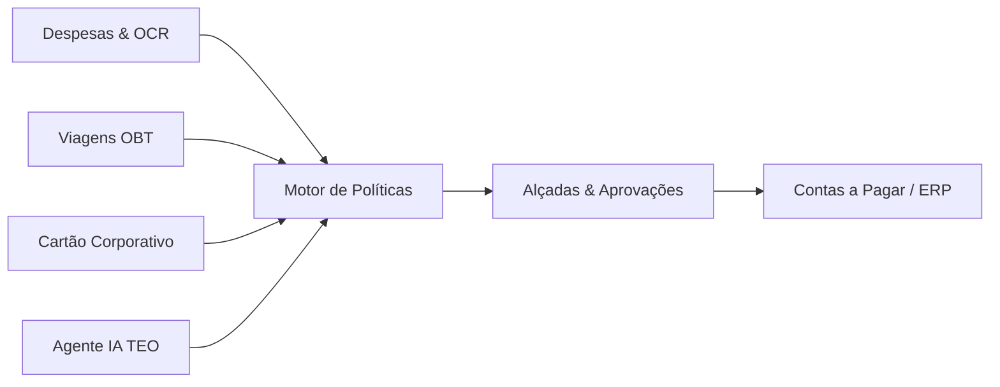

# Projeto Paytrack - Documentação Técnica e Levantamento de Requisitos

Bem-vindo ao repositório de documentação e engenharia de requisitos do ecossistema **Paytrack** (plataforma líder em gestão integrada de viagens, despesas corporativas, reembolsos e pagamentos).

---

## 📁 Estrutura de Documentação

A estrutura deste repositório segue os padrões de organização corporativa definidos em [`INDICE_PROJETOS.md`](file:///C:/Users/kbadmin/Documents/Projetos/INDICE_PROJETOS.md):

```text
C:\Users\kbadmin\Documents\Projetos\Mobilidade e Viagens\Paytrack\
│
├── 01_documentacao/
│   ├── 01_visao_geral_e_arquitetura.md          # Arquitetura sistêmica, componentes e topologia
│   ├── 02_levantamento_requisitos.md            # Requisitos Funcionais (RF), Não Funcionais (RNF) e Regras de Negócio (RN)
│   ├── 03_modulos_e_funcionalidades.md          # Detalhamento dos 5 módulos operacionais
│   ├── 04_guia_integracoes_e_api.md             # Especificação técnica de APIs REST, Webhooks e ERPs
│   ├── 05_matriz_rastreabilidade_e_casos_de_uso.md # Matriz MoSCoW e Casos de Uso (UC01 a UC08)
│   ├── 06_dossie_institucional_paytrack.md      # Dossiê de mercado: fundadores, rodadas, clientes e concorrência
│   ├── 07_estrategia_aquisicao_e_icp.md         # Estratégia de Go-to-Market, funil de vendas e Perfil de Cliente Ideal (ICP)
│   └── 08_metodologia_padrao_pesquisa_empresas.md # Framework e protocolo padrão para pesquisas futuras
│
├── GEMINI.md                                    # Regras de inteligência do workspace para Antigravity
└── README.md                                    # Índice executivo e diretrizes do projeto
```

---

## 📑 Mapa de Documentos Técnicos

| Documento | Descrição e Finalidade |
| :--- | :--- |
| **[01. Visão Geral e Arquitetura](file:///C:/Users/kbadmin/Documents/Projetos/Mobilidade%20e%20Viagens/Paytrack/01_documentacao/01_visao_geral_e_arquitetura.md)** | Diagramas de arquitetura C4/componentes, fluxo de dados ponta a ponta, camadas de apresentação, serviços e conformidade com LGPD e Duty of Care. |
| **[02. Levantamento de Requisitos](file:///C:/Users/kbadmin/Documents/Projetos/Mobilidade%20e%20Viagens/Paytrack/01_documentacao/02_levantamento_requisitos.md)** | Mapeamento de 5 personas corporativas, 23 Requisitos Funcionais (RF01-RF23), 10 Requisitos Não Funcionais (RNF01-RNF10) e 10 Regras de Negócio Críticas (RN01-RN10). |
| **[03. Módulos e Funcionalidades](file:///C:/Users/kbadmin/Documents/Projetos/Mobilidade%20e%20Viagens/Paytrack/01_documentacao/03_modulos_e_funcionalidades.md)** | Especificação dos módulos: Despesas & OCR, Viagens OBT & Hotéis, Cartão Corporativo & Conciliação em Tempo Real, Inteligência Artificial TEO e Governança/Auditoria. |
| **[04. Guia de Integrações e API](file:///C:/Users/kbadmin/Documents/Projetos/Mobilidade%20e%20Viagens/Paytrack/01_documentacao/04_guia_integracoes_e_api.md)** | Endpoints REST documentados com exemplos de payloads JSON, catálogo de Webhooks, estratégias para SAP, TOTVS Protheus, Senior Sapiens e layouts bancários. |
| **[05. Matriz e Casos de Uso](file:///C:/Users/kbadmin/Documents/Projetos/Mobilidade%20e%20Viagens/Paytrack/01_documentacao/05_matriz_rastreabilidade_e_casos_de_uso.md)** | Matriz de rastreabilidade com priorização MoSCoW e 8 Casos de Uso ponta a ponta (UC01 ao UC08) com diagramas de sequência. |
| **[06. Dossiê Institucional & Mercado](file:///C:/Users/kbadmin/Documents/Projetos/Mobilidade%20e%20Viagens/Paytrack/01_documentacao/06_dossie_institucional_paytrack.md)** | Análise aprofundada da empresa: história, fundadores, rodadas (Riverwood R$ 240M), grandes clientes (WEG, JBS, Sicredi) e comparativo com concorrentes (SAP Concur, Onfly, VExpenses). |
| **[07. Aquisição & ICP](file:///C:/Users/kbadmin/Documents/Projetos/Mobilidade%20e%20Viagens/Paytrack/01_documentacao/07_estrategia_aquisicao_e_icp.md)** | Motores de aquisição Go-to-Market, funil de vendas, canais (ABM, Inbound, programa de indicação de R$ 1.500) e perfil de cliente ideal (ICP Enterprise). |
| **[08. Metodologia Padrão de Pesquisa](file:///C:/Users/kbadmin/Documents/Projetos/Mobilidade%20e%20Viagens/Paytrack/01_documentacao/08_metodologia_padrao_pesquisa_empresas.md)** | Framework metodológico em 5 fases para replicação em pesquisas de mercado, benchmarks e novos concorrentes/parceiros. |

---

## 🚀 Principais Destaques do Ecossistema



- **Ciclo Automatizado de Despesas**: Leitura de cupons fiscais via OCR em segundos e cálculo de deslocamento por GPS com abatimento do trajeto casa-trabalho.
- **Online Booking Tool (OBT)**: Emissão de passagens aéreas, reservas de hotéis com teto tarifário municipal e proteção do colaborador (*Duty of Care*).
- **Conciliação Instantânea**: Notificação no smartphone do portador do cartão corporativo no milissegundo em que a compra é autorizada na maquininha para anexar o comprovante.
- **Auditoria Preditiva com IA**: Identificação de cupons duplicados, despesas fora de horário e consumo de itens proibidos pelas políticas da companhia.
- **Interoperabilidade Total**: Conectores e APIs para integração direta com ERPs legados (SAP S/4HANA/ECC, TOTVS Protheus/Datasul, Senior Sapiens, Sankhya e Omie).

---

## 🛠️ Próximos Passos Sugeridos

1. **Configuração de Ambiente de Homologação**: Solicitação de credenciais e API Keys junto à equipe de implantação da Paytrack.
2. **Definição de Parâmetros de Política**: Parametrização de tetos de despesas, janelas de antecedência de viagens e limites por cargo.
3. **Mapeamento de De-Para com o ERP**: Cruzamento de planos de contas, centros de custo e naturezas financeiras para automação de lançamentos contábeis.
